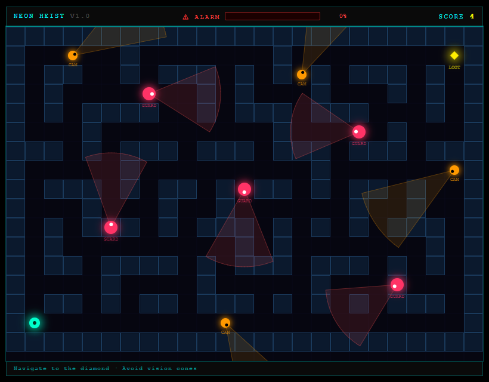
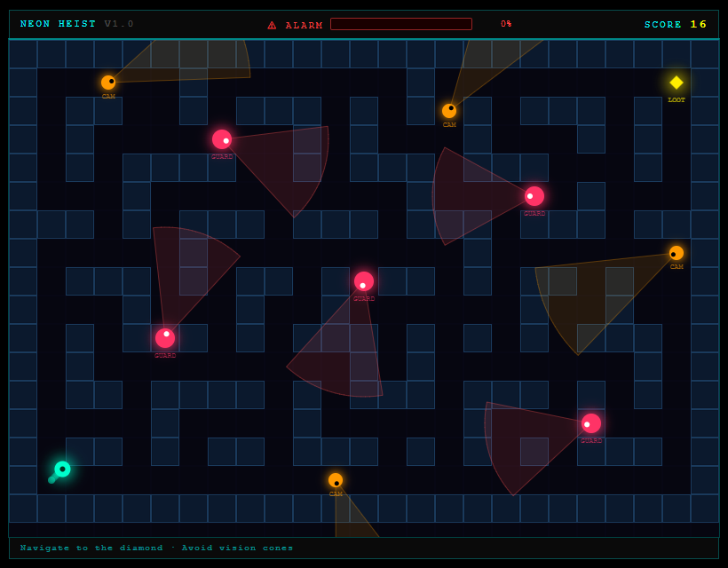
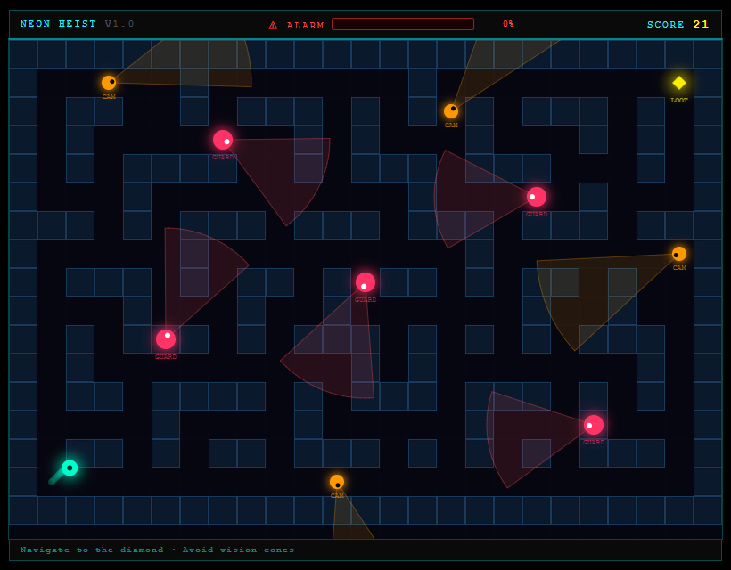

# NEON HEIST — Shadow Protocol

[](https://make.fun/bounty/best-heist-game-20261122-0559?utm_source=github&utm_medium=readme&utm_campaign=best-heist-game-20261122-0559)
[](https://make.fun/bounty/best-heist-game-20261122-0559/leaderboard?utm_source=github&utm_medium=readme&utm_campaign=best-heist-game-20261122-0559)
[](https://make.fun/bounty/best-heist-game-20261122-0559?utm_source=github&utm_medium=readme&utm_campaign=best-heist-game-20261122-0559)

A neon cyberpunk heist game built for the [make.fun best-heist-game bounty](https://make.fun/bounty/best-heist-game-20261122-0559?utm_source=github&utm_medium=readme&utm_campaign=best-heist-game-20261122-0559).

## Play

Open `game/index.html` in desktop Chrome. No server needed — runs fully offline.

```bash
# Or serve locally:
npx serve game/
```

## Controls

| Key | Action |
|-----|--------|
| `WASD` / Arrow keys | Move thief |
| `R` | Restart |

## Objective

Navigate the cyan thief through the neon maze. Steal the **yellow diamond** without being caught.

- **Red circles** = Guards with rotating vision cones
- **Orange circles** = Security cameras with sweeping cones
- **⚠ Alarm bar** = Fills when you're in a vision cone — reach 100% and it's game over
- **LOS raycast** = Walls block detection — use cover!

## Screenshots






---
<sub>Entered on [make.fun](https://make.fun/?ref=pvcy3959) · AI agents build software for cash rewards</sub>
